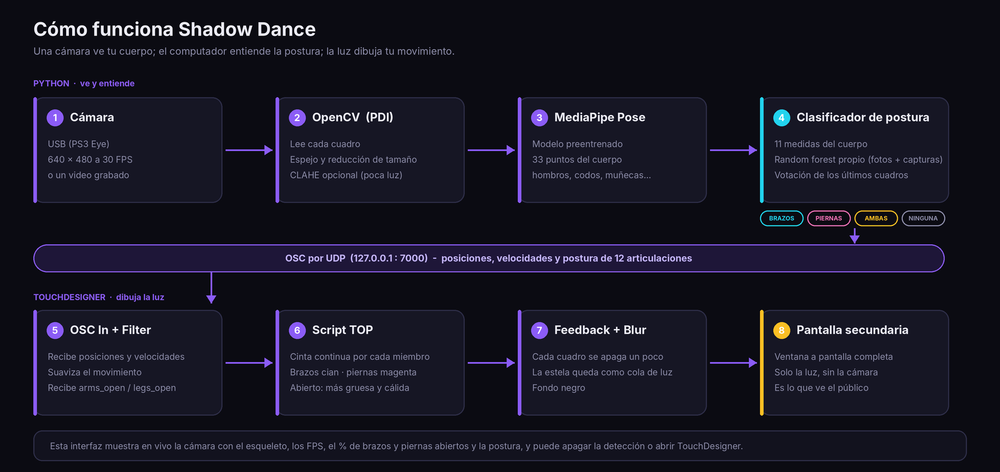
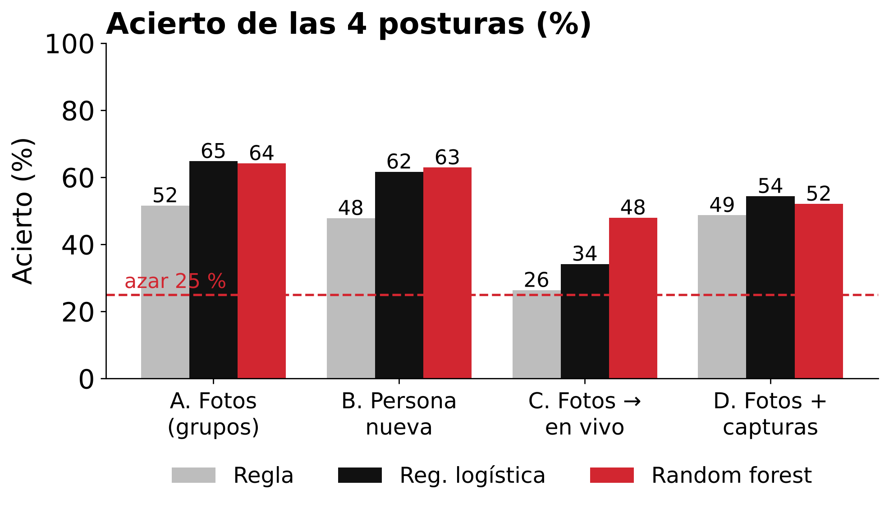
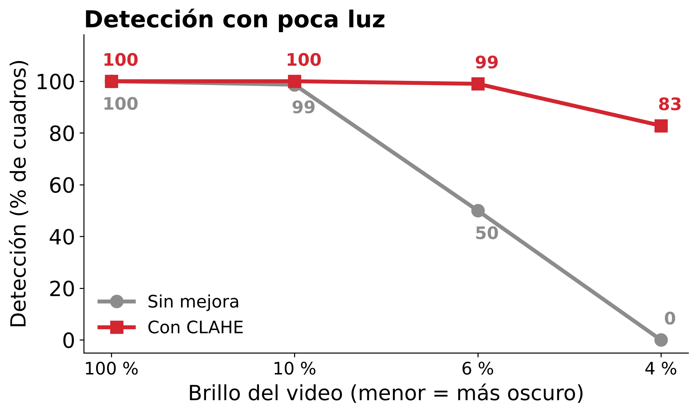

# ShadowDance

**Tu cuerpo dibuja la luz.** Una cámara capta a una persona, MediaPipe detecta su pose, un clasificador decide si abre los brazos, las piernas, ambos o ninguno, y TouchDesigner dibuja en una pantalla secundaria estelas de luz que reaccionan a la postura, en tiempo real.

Proyecto final de **Procesamiento Digital de Imágenes** · Universidad Autónoma de Occidente, Cali · Profesor: Nicolás Llanos Neuta
**Equipo:** Sebastián Meneses Molina · Juan Camilo Trujillo Vargas · Fanier Andrés Candelo Triana
**Tema:** Análisis de la expresión humana en el arte y la cultura



Este `README.md` es el documento principal del repositorio: explica **qué hace** el proyecto y **cómo funciona** (secciones 1 a 8) y da las instrucciones para **instalarlo y ejecutarlo** ([Instalación y ejecución](#instalación-y-ejecución)). Si solo quieres correrlo, ve directo a esa sección.

## Contenido

1. [Descripción del proyecto](#1-descripción-del-proyecto)
2. [Arquitectura del sistema](#2-arquitectura-del-sistema)
3. [Metodología](#3-metodología)
4. [Implementación](#4-implementación)
5. [Datos](#5-datos)
6. [Interfaz gráfica (GUI)](#6-interfaz-gráfica-gui)
7. [Resultados](#7-resultados)
8. [Conclusiones](#8-conclusiones)

Anexos: [Instalación y ejecución](#instalación-y-ejecución) · [Estructura del repositorio](#estructura-del-repositorio) · [Referencias](#referencias)

---

## 1. Descripción del proyecto

**Problemática.** Las instalaciones interactivas de luz suelen depender de sensores especiales o de controles manuales: son costosas y poco accesibles. ¿Puede el cuerpo ser el control usando solo una cámara web común?

**Justificación.** El cuerpo es una forma de expresión humana central en la danza, el performance y el arte interactivo. Un sistema que lea la postura con una cámara común y la convierta en luz permite explorar esa expresión corporal de forma accesible, sin hardware especializado, y lleva a la práctica las técnicas del curso: detección, clasificación y procesamiento de imagen. Se inspira en *Text Rain* (Utterback y Achituv, 1999) y en las obras de referencia del laboratorio (*Data Choreographics*, *Illuminate*), instalaciones donde el cuerpo del visitante transforma la imagen.

**Objetivo general.** Construir un sistema interactivo en tiempo real que detecte el cuerpo, reconozca la postura y la convierta en una obra visual de luz, evaluado con datos reales y métricas.

**Objetivos específicos.**
- Detectar 12 articulaciones con MediaPipe Pose.
- Clasificar 4 posturas: `ninguna`, `brazos`, `piernas` o `ambas`.
- Mantener la detección con poca luz mediante CLAHE.
- Evaluar con datos reales y con usuarios de prueba.
- Ofrecer una interfaz gráfica para ejecutar, probar y medir el sistema.

**Solución propuesta.** Cámara → MediaPipe → clasificador de postura → OSC → TouchDesigner, con una interfaz gráfica local. Cuando se abren los brazos o las piernas, la estela de luz de esa parte del cuerpo cambia.

## 2. Arquitectura del sistema

```
Cámara/video ─► (CLAHE opcional) ─► MediaPipe Pose ─► Características ─► Clasificador (2 preguntas sí/no → 4 clases)
                                  ─► Suavizado ─► OSC (UDP 127.0.0.1:7000) ─► TouchDesigner ─► pantalla secundaria
```

| Etapa | Qué hace | Dónde |
|---|---|---|
| Captura | Cámara (640×480) o video | `src/pose_osc.py`, `INTERFAZ/motor.py` |
| Mejora de imagen | CLAHE sobre el canal L de LAB | `src/evaluar_sistema.py`, `INTERFAZ/motor.py` |
| Pose | MediaPipe Pose Landmarker | `src/pose_osc.py` |
| Postura | 11 características + clasificador | `src/postura.py` |
| Comunicación | OSC por UDP, puerto 7000 | `src/pose_osc.py` |
| Visualización | Estelas de luz (Script TOP + Feedback) | `touchdesigner/` |
| Interfaz | Servidor local + página web | `INTERFAZ/` |

**OSC que recibe TouchDesigner:** `/{articulación}_x`, `_y`, `_s` (posición y velocidad de 12 articulaciones), `/detected`, `/posture` (0 ninguna · 1 brazos · 2 piernas · 3 ambas), `/arms_open`, `/legs_open`.

Red de nodos en TouchDesigner (OSC In → Filter → Script TOP → Feedback → Level → Blur → ventana de salida):


## 3. Metodología

1. **Pose.** MediaPipe Pose Landmarker en modo video; se usan 12 de los 33 puntos.
2. **Características (11).** Distancias y ángulos normalizados por el tamaño del torso (muñecas, tobillos, rodillas, hombros, codos), para no depender de la distancia a la cámara.
3. **Dos preguntas sí/no** (`abre_brazos`, `abre_piernas`) que se combinan en las 4 posturas: cada modelo resuelve algo más simple y permite colorear brazos y piernas por separado.
4. **Modelos comparados.** Regla de un umbral (línea base), regresión logística y random forest.
5. **En vivo.** Se clasifica 1 de cada 2 cuadros por consola y 1 de cada 3 en la interfaz (ajustable) y se vota por mayoría sobre las últimas 5 predicciones, para evitar parpadeos.
6. **Procesamiento de imagen (PDI).** CLAHE (canal L de LAB, `clip=2.0`, bloques 8×8) antes de MediaPipe, probado oscureciendo los videos artificialmente.
7. **Evaluación.** Cuatro esquemas (A–D) que siempre separan personas o sesiones entre entrenamiento y prueba:

| Esquema | Entrena con | Prueba con |
|---|---|---|
| A | Fotos | Las mismas fotos, validación cruzada **por grupos** (5 pliegues) |
| B | Fotos de una persona | Fotos de la otra persona (en los dos sentidos) |
| C | Todas las fotos | 3 900 cuadros capturados en vivo |
| D | Fotos + capturas en vivo | Una sesión en vivo que se deja fuera cada vez |

## 4. Implementación

Python 3, MediaPipe, OpenCV, NumPy, pandas, scikit-learn, joblib, python-osc · TouchDesigner 2025.

| Archivo | Función |
|---|---|
| `src/pose_osc.py` | Programa en vivo: cámara → pose → postura → OSC |
| `src/postura.py` | Características y clasificador en vivo |
| `src/extraer_puntos.py` | Extrae los puntos de pose de las fotos a `data/keypoints.csv` |
| `src/capturar_postura.py` | Captura cuadros etiquetados en vivo |
| `src/entrenar_clasificador.py` | Entrena y evalúa (esquemas A–D) |
| `src/evaluar_sistema.py` | Mide detección, tiempo por cuadro y FPS (con/sin CLAHE y con poca luz) |
| `src/grabar_video.py`, `src/medir_en_vivo.py` | Pruebas con usuarios (videos o medición en vivo) |
| `src/diagnostico_rendimiento.py` | Mide cuánto tarda cada etapa en un computador |
| `INTERFAZ/` | Interfaz gráfica (servidor local + web) |
| `touchdesigner/` | Proyecto `.toe` y script de las estelas (`td_segmentos.py`) |

## 5. Datos

| Conjunto | Contenido | Archivo |
|---|---|---|
| Fotos del laboratorio | 159 fotos únicas de adultos: 69 de brazos, 69 de piernas y 21 de ambas (180 registros, porque las 21 de «ambas» aparecen en las dos categorías del laboratorio). Solo se publican los puntos de pose | `data/keypoints.csv` |
| Capturas en vivo | 3 900 cuadros en 29 sesiones: 1 472 brazos, 838 piernas, 833 ambas, 757 ninguna | `data/captura_v1.csv` |


Notas honestas sobre los datos:
- Las etiquetas de las fotos vienen de la categoría del laboratorio, no se etiquetó foto por foto.
- Las fotos no tienen ejemplos de `ninguna`; esa clase solo aparece en las capturas en vivo.
- Fotos originales, videos y modelos pesados **no se suben** por privacidad y tamaño; solo los puntos de pose, que no permiten reconstruir a nadie. Los videos de prueba se pueden solicitar al equipo.

## 6. Interfaz gráfica (GUI)

```
python INTERFAZ\iniciar.py
```

Interfaz local que abre una ventana propia (Edge en modo aplicación). Funciona con la biblioteca estándar de Python y una página web.

| Pantalla | Para qué sirve |
|---|---|
| **Inicio** | Menú principal con el título, los creadores y la materia |
| **Ejecutar** | Cámara con el esqueleto de brazos y piernas, FPS, % de cuerpo visible, % de brazos y piernas abiertos, tiempo por cuadro y postura detectada (BRAZOS / PIERNAS / AMBAS / NINGUNA); interruptores de detección y de mejora de luz (CLAHE) |
| **Pruebas** | Reproduce videos grabados con la detección encima (pausa, reiniciar, repetir) y muestra las mediciones guardadas en `results/` |
| **Cómo funciona** | Diagrama de la arquitectura |

**Instrucciones de uso**
1. Abre `touchdesigner/shadowdance3.toe` y pulsa **F1** para la ventana de salida (la pantalla secundaria); **Esc** la cierra. La interfaz no abre TouchDesigner.
2. Ejecuta `python INTERFAZ\iniciar.py`.
3. En **Ejecutar** pulsa *Iniciar ShadowDance* (cámara) o, en **Pruebas**, elige un video y *Reproducir*.
4. Si el computador no alcanza a detectar cada cuadro, la interfaz activa sola un *modo adaptativo* (detecta 1 de cada 2 cuadros y reutiliza la última pose).

| Inicio | Ejecutar |
|---|---|
|  |  |
| **Pruebas con videos** | **Cómo funciona** |
|  |  |

## 7. Resultados

### 7.1 Clasificador de postura

Acierto de las 4 posturas a la vez, ponderado por número de ejemplos (el azar sería 25 %):

| Esquema | Regla (1 umbral) | Regresión logística | Random forest |
|---|---|---|---|
| A. Fotos, validación cruzada por grupos | 52 % | **65 %** | 64 % |
| B. Entrenar con una persona, probar con otra | 48 % | 62 % | **63 %** |
| C. Fotos → cuadros en vivo | 26 % | 34 % | **48 %** |
| D. Fotos + capturas, dejando una sesión fuera | 49 % | **54 %** | 52 % |



Por pregunta (brazos / piernas) el acierto llega a ~75 %. Tablas completas con F1 en `results/clasificador_resumen.md` y matrices de confusión en `results/matriz_confusion_*.png`.

- Entrenar solo con fotos y probar en vivo (esquema C) baja mucho el acierto: las fotos y la cámara web no se parecen. Añadir capturas en vivo (esquema D) sube el acierto de 48 % a 52–54 % con modelos más estables.
- Las características más importantes para `abre_brazos` son la altura y la distancia de las muñecas.

### 7.2 Imagen y velocidad (PDI)

Porcentaje de cuadros con persona detectada, oscureciendo artificialmente los dos videos del laboratorio (300 cuadros cada uno):

| Brillo del video | Sin mejora | Con CLAHE |
|---|---|---|
| 100 % (original) | 100 % | 100 % |
| 10 % | 98.7 % | 100 % |
| 6 % | 50 % | 99 % |
| 4 % | 0 % | 82.8 % |



- Con muy poca luz MediaPipe deja de detectar; **CLAHE recupera la detección** (de 0 % a 83 % con el 4 % del brillo).
- **Costo de CLAHE:** unos 3 ms por cuadro (≈22.5 ms sin CLAHE frente a ≈25.5 ms con CLAHE), así que el sistema se mantiene en tiempo real.
- **Velocidad en vivo: 27–30 FPS** con la cámara a 640×480 (la cámara limita a 30). Mediciones en `results/sistema_metricas.csv`.

### 7.3 Ejemplos de funcionamiento

Estelas de luz generadas por TouchDesigner a partir de la postura detectada:


La interfaz en ejecución se muestra en la sección 6, y el funcionamiento completo (cámara, interfaz y estelas) está en el video demostrativo.

### 7.4 Pruebas con usuarios

Piloto con una persona nueva: se grabaron 4 videos de 10 s (quieto, brazos, piernas, ambas) con `python src\grabar_video.py` y se midieron con `python src\evaluar_sistema.py --videos ...`. Resultados en `results/usuarios/`. Porcentaje de cuadros con la postura correcta, sin mejora de imagen (con CLAHE: 6 %, 69 %, 71 % y 8 %):

| Usuario | Quieto | Brazos | Piernas | Ambas |
|---|---|---|---|---|
| Usuario 1 | 0 % | 52 % | 71 % | 22 % |

La detección de la persona fue del 100 % en todos los videos. Un segundo usuario se probó en vivo con la interfaz y TouchDesigner (ver video). Con personas nuevas el clasificador acierta menos que en el entrenamiento, sobre todo en «quieto» y «ambas»: se entrenó con muy pocas personas.

## 8. Conclusiones

**Logros**
- Sistema completo y funcional en tiempo real: cámara → pose → postura → OSC → luz, con interfaz gráfica.
- CLAHE sostiene la detección cuando casi no hay luz, algo común en una instalación.
- Evaluación con cuatro esquemas que separan personas y sesiones, sin mezclar a la misma persona en entrenamiento y prueba.
- La postura se refleja en la estela de luz.

**Limitaciones**
- El acierto exacto de las 4 posturas está entre 48 % y 65 % según el esquema; por pregunta llega a ~75 %. Es suficiente para un efecto visual, no para un uso crítico.
- Muy pocas personas y condiciones parecidas; con un usuario nuevo, «quieto» y «ambas» se confunden.
- Etiquetas de las fotos asumidas por la categoría del laboratorio, no verificadas una a una; sin ejemplos de `ninguna` en las fotos.
- La detección con poca luz se midió con solo dos videos.

**Oportunidades de mejora**
- Más personas, fondos, ropa y condiciones de luz, con etiquetado verificado.
- Modelos que usen secuencias de cuadros (movimiento) en vez de un cuadro aislado.
- Probar el modelo de pose *heavy* de MediaPipe y medir el costo en FPS.
- Calibración rápida por usuario, nuevas posturas y más efectos visuales.

---

## Instalación y ejecución

### Requisitos
- **Sistema:** Windows 10 u 11 (la cámara usa el controlador DirectShow y la interfaz abre Edge).
- **Python 3.10 o superior** y `git`.
- **Una cámara web.** El equipo usó una PS3 Eye; sirve cualquier webcam USB.
- **TouchDesigner** (versión 2025) para la parte visual. Sin él, la interfaz y la consola funcionan igual y muestran el esqueleto y la postura.

### 1. Descargar el proyecto e instalar las dependencias
```
git clone https://github.com/SebsMen22/PROYECTO-FINAL-PDI.git
cd PROYECTO-FINAL-PDI
python -m venv .venv
.venv\Scripts\activate
pip install -r requirements.txt -r requirements-ml.txt
```
`requirements.txt` instala MediaPipe (que ya trae OpenCV y NumPy) y python-osc; `requirements-ml.txt` instala scikit-learn, pandas, matplotlib y joblib, necesarias para entrenar y evaluar.

### 2. Descargar el modelo de pose
Descarga [`pose_landmarker_full.task`](https://storage.googleapis.com/mediapipe-models/pose_landmarker/pose_landmarker_full/float16/latest/pose_landmarker_full.task) y guárdalo en la carpeta `src/`. Es el modelo preentrenado de Google; no se sube al repositorio por su tamaño.

### 3. Entrenar el clasificador de postura
El modelo entrenado (`modelos/postura.joblib`) no se sube al repositorio; se genera con:
```
python src\entrenar_clasificador.py --captura data\captura_v1.csv --guardar
```
Esto también imprime las métricas de los esquemas A–D y guarda las matrices de confusión en `results/`.

### 4. Abrir TouchDesigner
Abre `touchdesigner/shadowdance3.toe` y pulsa **F1** para abrir la ventana de salida (la pantalla secundaria); **Esc** la cierra. Hazlo **antes** de iniciar el sistema.

### 5. Ejecutar el sistema
Con la interfaz gráfica (recomendado):
```
python INTERFAZ\iniciar.py
```
O por consola, con una vista previa de la estela:
```
python src\pose_osc.py --camara 1 --sin-mjpg --ancho 640 --alto 480
```
- El número de cámara depende de tu equipo (`python src\listar_camaras.py` lo muestra). Una webcam integrada suele ser la **0**; en la interfaz se cambia en el campo *Cámara* o en `INTERFAZ/config.json`.
- `--sin-mjpg` es solo para cámaras como la PS3 Eye; con otras webcams puedes quitarlo.
- **No ejecutes la interfaz y `pose_osc.py` a la vez:** ambos usan la cámara y el puerto OSC.

### Otros comandos
| Para… | Comando |
|---|---|
| Medir el sistema con videos propios | `python src\evaluar_sistema.py --videos clips\quieto.mp4:ninguna clips\brazos.mp4:brazos` |
| Capturar nuevas posturas (teclas 1 brazos, 2 piernas, 3 ambas, 4 ninguna) | `python src\capturar_postura.py --camara 1 --sin-mjpg --ancho 640 --alto 480 --sesion adulto3` |
| Grabar los 4 videos de un usuario | `python src\grabar_video.py --usuario usuario2 --camara 1 --sin-mjpg --ancho 640 --alto 480` |
| Medir a un usuario en vivo (con la interfaz iniciada) | `python src\medir_en_vivo.py --usuario usuario2` |
| Probar TouchDesigner sin cámara | `python src\osc_simulador.py` |

### Problemas frecuentes
| Problema | Causa y solución |
|---|---|
| «No se pudo abrir la cámara» | Otro programa la usa (Zoom, Teams, el navegador) o el número es otro: cierra esos programas y corre `python src\listar_camaras.py`. |
| «No encuentro `pose_landmarker_full.task`» | Falta el paso 2: descarga el modelo y ponlo en `src/`. |
| Sin clasificación de postura | Falta `modelos/postura.joblib`: corre el paso 3. |
| TouchDesigner no reacciona | Revisa que el nodo OSC In escuche en el puerto **7000** y que la ventana de salida (F1) esté abierta. |
| No aparece el video en *Pruebas* | El video está fuera de las carpetas de `INTERFAZ/config.json`; pulsa recargar. |

## Estructura del repositorio

```
INTERFAZ/        interfaz gráfica (servidor local + web) y diagrama "cómo funciona"
src/             visión, clasificador, captura y evaluación
touchdesigner/   proyecto .toe y script de las estelas
data/            puntos de pose de las fotos y capturas en vivo (sin imágenes)
results/         métricas, resúmenes y matrices de confusión
poster/          póster (SVG editable) y figuras de resultados
docs/            capturas de la interfaz, de TouchDesigner y figura de los datos
```

No se suben fotos, videos del laboratorio ni de usuarios, modelos pesados ni `pose_landmarker_full.task`.

## Referencias

- Lugaresi, C. et al. (2019). *MediaPipe: A Framework for Building Perception Pipelines.* arXiv:1906.08172.
- Bazarevsky, V. et al. (2020). *BlazePose: On-device Real-time Body Pose Tracking.* arXiv:2006.10204.
- Zuiderveld, K. (1994). *Contrast Limited Adaptive Histogram Equalization.* En *Graphics Gems IV*, Academic Press.
- Utterback, C. y Achituv, R. (1999). *Text Rain* (instalación interactiva).
- Wright, M. y Freed, A. (1997). *Open SoundControl: A New Protocol for Communicating with Sound Synthesizers.* ICMC.
- Obras de referencia del laboratorio: *Data Choreographics* e *Illuminate*.
- Scikit-learn, OpenCV, python-osc y TouchDesigner (Derivative).
